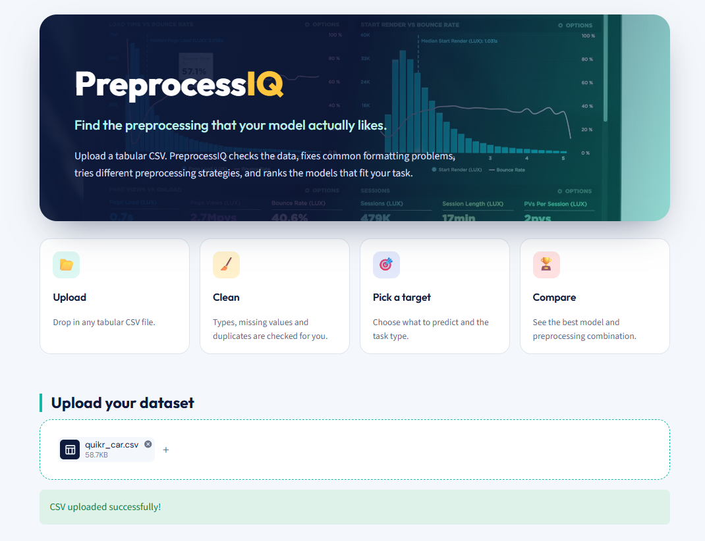
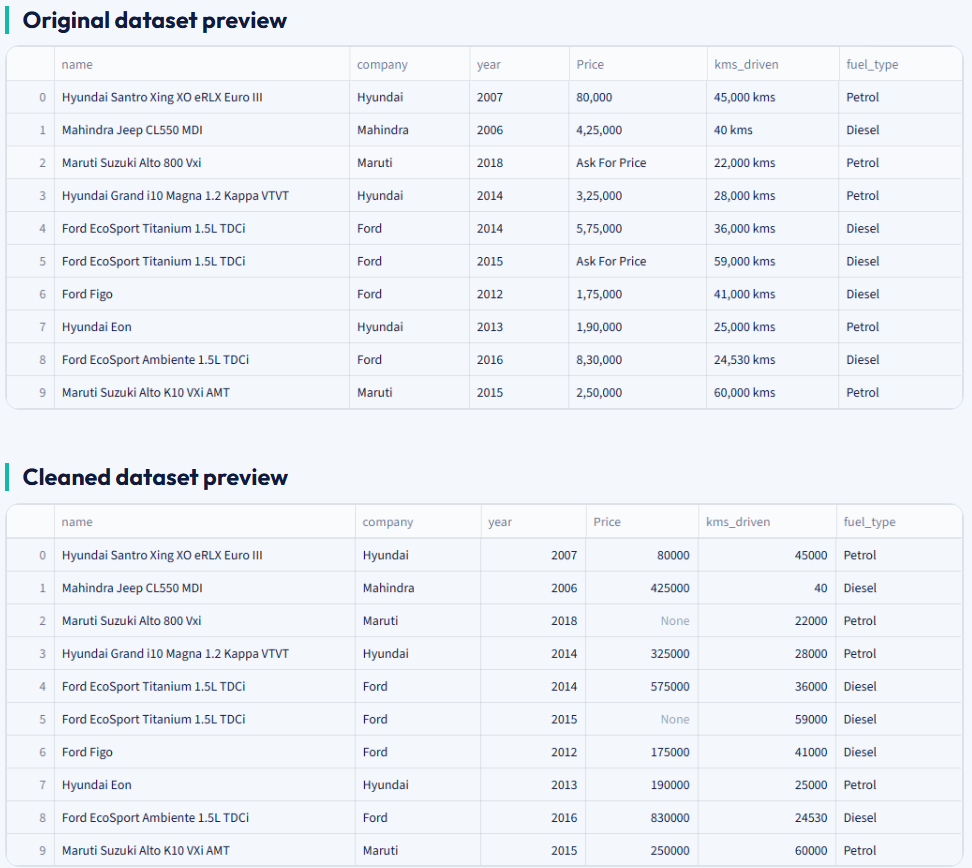
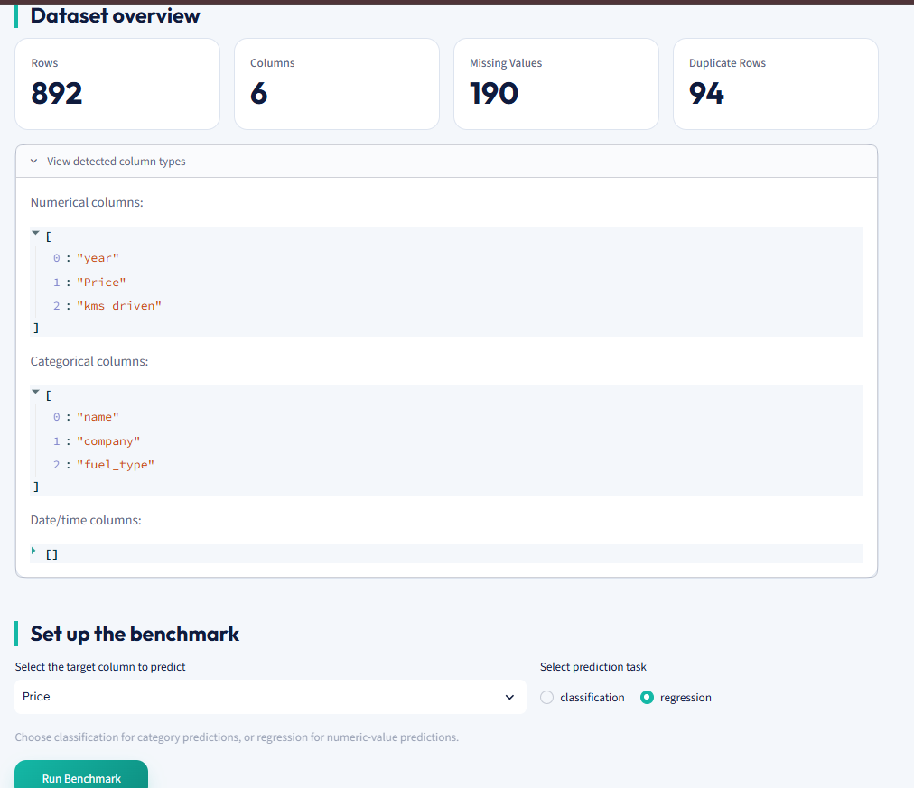
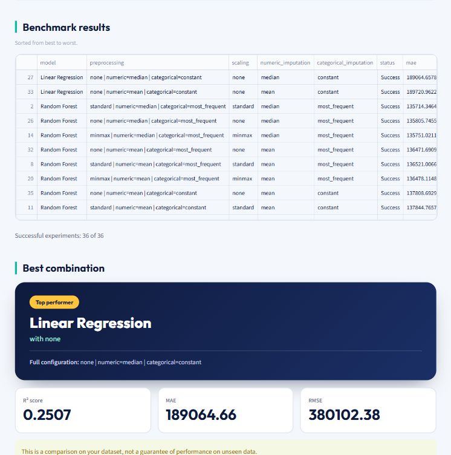

# PreprocessIQ
### Simplifying Machine Learning Preprocessing Through Intelligent Benchmarking

<p align="center">
  <strong>Upload. Prepare. Benchmark. Compare.</strong>
  <br>
  An interactive platform that brings data preprocessing and machine learning model evaluation together in one place.
</p>

---

## About the Project

Machine learning performance depends not only on the algorithm selected but also on how the data is prepared. Choosing the right imputation strategy, scaling technique, and model can significantly influence the final results.

**PreprocessIQ** is an interactive machine learning preprocessing and benchmarking platform built using Python and Streamlit. It simplifies this experimentation process by allowing users to inspect datasets, prepare data, explore different preprocessing configurations, and compare machine learning models through cross-validation.

Rather than manually testing preprocessing techniques and algorithms one by one, PreprocessIQ automates the comparison process and helps identify the best-performing combination for a given dataset.

The platform supports both **Classification and Regression** tasks and provides an intuitive interface to understand the complete workflow, from uploading a dataset to evaluating benchmark results.

The application uses `quikr_car.csv` as an example dataset, but users can upload other compatible CSV datasets.

## Why PreprocessIQ?

Preprocessing is an essential part of every machine learning workflow, yet selecting suitable techniques often involves repetitive experimentation.

PreprocessIQ addresses this by bringing the major stages of data preparation and model comparison into a single application.

- **Less Manual Experimentation:** Automatically evaluates multiple preprocessing configurations instead of requiring users to test each one separately.
- **Structured Data Preparation:** Helps inspect and prepare datasets before model training.
- **Fairer Model Comparison:** Uses cross-validation to compare different preprocessing and model combinations.
- **Task-Based Benchmarking:** Supports separate workflows for classification and regression.
- **Clear Performance Insights:** Presents benchmark results to help users identify the best-performing combination.

## Key Features

| Feature | Description |
|---|---|
| Dataset Upload | Upload CSV datasets for analysis and benchmarking. |
| Dataset Inspection | Examine dataset dimensions, data types, missing values, and duplicate records. |
| Automated Data Preparation | Handle common data-quality issues and prepare features for modelling. |
| Original vs. Cleaned Data | Compare the dataset before and after preparation. |
| Target Selection | Choose the target column for the machine learning task. |
| Classification & Regression | Select the appropriate task based on the target variable. |
| Preprocessing Configurations | Experiment with different scaling and imputation strategies. |
| Model Benchmarking | Evaluate multiple machine learning algorithms. |
| Cross-Validation | Assess model performance using cross-validation. |
| Performance Comparison | Compare evaluation metrics across different combinations. |
| Best Combination | Identify the best-performing preprocessing and model combination. |

## How PreprocessIQ Works

The application follows a simple four-stage workflow:

<details>
<summary><strong>01 — Upload</strong></summary>

Upload a CSV dataset and begin exploring its structure and contents.

</details>

<details>
<summary><strong>02 — Clean</strong></summary>

Inspect the original dataset, handle common data-quality issues, and review the prepared dataset.

</details>

<details>
<summary><strong>03 — Pick a Target</strong></summary>

Select the target column and choose whether the problem is a classification or regression task.

</details>

<details>
<summary><strong>04 — Compare</strong></summary>

Run the benchmarking process, evaluate different preprocessing and model combinations, and identify the best-performing configuration.

</details>

### Workflow Architecture


## Application Previews

Explore the different stages of PreprocessIQ through the following application screenshots.

### Preview 1 — Dataset Upload Interface

The application begins with a clean and intuitive interface introducing four main stages: Upload, Clean, Pick a Target, and Compare. Users can upload their CSV dataset to start the preprocessing and benchmarking workflow.



### Preview 2 — Dataset Inspection and Cleaning

This stage displays the original dataset alongside the cleaned dataset, allowing users to examine the data before and after automated preparation.



### Preview 3 — Dataset Overview and Benchmark Configuration

Review important dataset information, select the target variable, and configure the appropriate machine learning task before benchmarking.



### Preview 4 — Benchmark Results and Best Combination

Compare the performance of different preprocessing and machine learning combinations and identify the best-performing configuration based on the evaluation metrics.



## Technology Stack

| Technology | Application |
|---|---|
| Python | Core programming language |
| Streamlit | Interactive application interface |
| Pandas | Data manipulation and analysis |
| NumPy | Numerical computations |
| Scikit-learn | Data preprocessing, machine learning models, pipelines, cross-validation, and evaluation |
| Plotly | Interactive visualizations, where used in the application |

## Project Files

- **`app.py`** — Main Streamlit application responsible for the interface, dataset upload, workflow navigation, and presentation of benchmark results.
- **`benchmark.py`** — Core implementation of dataset inspection, data preparation, preprocessing configurations, model benchmarking, cross-validation, and performance evaluation.
- **`.streamlit/config.toml`** — Streamlit application configuration.
- **`assets/`** — Contains the four application preview screenshots used in this README.
- **`requirements.txt`** — Lists the Python dependencies required to run the application.
- **`.gitignore`** — Specifies files and directories that should be excluded from Git tracking.

## Getting Started

Follow these instructions to set up and run PreprocessIQ on your local machine.

### Prerequisites

- Python installed on your system.
- Git installed on your system.
- A compatible CSV dataset.

### 1. Clone the Repository

```bash
git clone <your-github-repository-url>
```

### 2. Navigate to the Project Directory

```bash
cd PreprocessIQ
```

### 3. Create a Virtual Environment

```bash
python -m venv venv
```

### 4. Activate the Virtual Environment

**Windows**

```bash
venv\Scripts\activate
```

**macOS / Linux**

```bash
source venv/bin/activate
```

### 5. Install the Dependencies

```bash
pip install -r requirements.txt
```

### 6. Launch the Application

```bash
streamlit run app.py
```

Once the application starts, open the local URL displayed in your terminal to access PreprocessIQ.

## How to Use

1. Open PreprocessIQ in your browser.
2. Upload a compatible CSV dataset.
3. Inspect the dataset overview and data quality.
4. Review the original and cleaned dataset.
5. Select the target column.
6. Choose the classification or regression task.
7. Start the benchmarking process.
8. Compare the model and preprocessing results.
9. Identify the best-performing combination.

## Limitations

- Currently supports CSV dataset uploads.
- Automated preparation focuses on common data-quality issues; complex datasets may require additional manual preparation.
- Benchmarking performance can vary depending on dataset size, feature characteristics, and target selection.
- The best-performing combination is determined using the evaluation metrics implemented for the selected machine learning task.

## Future Scope

PreprocessIQ can be extended with several additional capabilities:

- Support for Excel and other dataset formats.
- More preprocessing techniques and machine learning algorithms.
- Additional evaluation metrics and comparison visualizations.
- Model export and deployment functionality.
- Advanced benchmarking configurations.
- More detailed performance analysis and reporting.

## Project Objective

The goal of PreprocessIQ is to make machine learning experimentation more structured, accessible, and efficient.

By integrating dataset inspection, automated data preparation, preprocessing pipelines, cross-validation, and model benchmarking into one interactive platform, the project aims to reduce repetitive experimentation and help users make more informed decisions when building machine learning workflows.

---

<p align="center">
  <strong>PreprocessIQ — Prepare Smarter. Benchmark Better.</strong>
</p>
