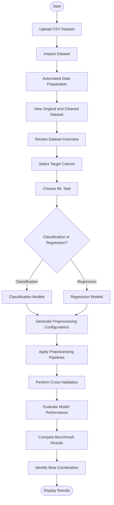

# PreprocessIQ

### An Intelligent Benchmarking Platform for Machine Learning Preprocessing

## Overview

PreprocessIQ is a Streamlit-based application designed to simplify data preprocessing and evaluate different preprocessing techniques for machine learning tasks.

The platform allows users to upload CSV datasets, inspect their contents, prepare data, select a target variable, and compare multiple combinations of preprocessing techniques and machine learning models.

Instead of manually experimenting with different preprocessing configurations, PreprocessIQ automates the benchmarking process and identifies the best-performing combination based on model evaluation metrics.

The application currently uses `quikr_car.csv` as an example dataset. However, users can upload other compatible CSV datasets.

## Key Features

- **CSV Dataset Upload:** Upload datasets in CSV format for analysis and preprocessing.
- **Dataset Inspection:** View dataset dimensions, column information, missing values, duplicate records, and data types.
- **Automated Data Preparation:** Handle missing values, convert suitable numeric-looking columns, process date-like columns, and prepare features for modelling.
- **Original vs. Cleaned Dataset:** Compare the original dataset with the prepared dataset.
- **Target Selection:** Select the target column according to the machine learning task.
- **Classification and Regression:** Support both classification and regression problems.
- **Preprocessing Comparison:** Evaluate different combinations of scaling and imputation techniques.
- **Model Benchmarking:** Compare multiple machine learning algorithms using cross-validation.
- **Performance Evaluation:** Analyse model performance using relevant evaluation metrics.
- **Best Combination Identification:** Identify the best-performing preprocessing and model combination.

## How It Works

PreprocessIQ follows a structured workflow:

1. **Upload:** Upload a CSV dataset.
2. **Inspect:** Examine the dataset and understand its structure.
3. **Clean:** Prepare the dataset by handling common data-quality issues.
4. **Pick a Target:** Select the target column and specify the machine learning task.
5. **Configure:** Generate different preprocessing configurations.
6. **Benchmark:** Apply preprocessing pipelines and evaluate suitable machine learning models using cross-validation.
7. **Compare:** Compare the performance of different combinations.
8. **Results:** Display benchmark results and identify the best-performing combination.

### Workflow Flowchart



## Application Previews

### Preview 1


### Preview 2


### Preview 3


### Preview 4


## Technology Stack

| Technology | Purpose |
|---|---|
| Python | Core programming language |
| Streamlit | Interactive web application |
| Pandas | Dataset manipulation and analysis |
| NumPy | Numerical operations |
| Scikit-learn | Preprocessing, machine learning models, and evaluation |
| Plotly | Data visualization, where used by the application |

## File Descriptions

- **`app.py`** – Main Streamlit application containing the user interface, dataset upload functionality, workflow navigation, and benchmark result presentation.
- **`benchmark.py`** – Contains the core preprocessing, dataset inspection, feature preparation, model benchmarking, cross-validation, and evaluation logic.
- **`.streamlit/config.toml`** – Contains Streamlit application configuration settings.
- **`assets/`** – Stores the application preview screenshots displayed in this README.
- **`requirements.txt`** – Contains the Python dependencies required to run the application.
- **`.gitignore`** – Specifies files and directories that should not be tracked by Git.

## Installation and Setup

Follow these steps to run PreprocessIQ locally.

### 1. Clone the Repository

```bash
git clone <your-github-repository-url>
```

### 2. Navigate to the Project Directory

```bash
cd PreprocessIQ
```

### 3. Create a Virtual Environment

```bash
python -m venv venv
```

### 4. Activate the Virtual Environment

**Windows:**

```bash
venv\Scripts\activate
```

**macOS / Linux:**

```bash
source venv/bin/activate
```

### 5. Install Dependencies

```bash
pip install -r requirements.txt
```

### 6. Run the Application

```bash
streamlit run app.py
```

The application will open in your default web browser.

## Usage

1. Launch the application.
2. Upload a CSV dataset.
3. Inspect the dataset overview and its contents.
4. Review the original and cleaned dataset.
5. Select the target column.
6. Choose classification or regression.
7. Run the benchmarking process.
8. Compare the evaluation results.
9. Review the best-performing preprocessing and model combination.

## Limitations

- The application currently accepts CSV datasets.
- Dataset preparation is designed to handle common data-quality issues and may require additional handling for highly complex datasets.
- Benchmarking performance depends on dataset size, feature characteristics, and the selected machine learning task.
- The best-performing combination is determined using the evaluation metrics implemented for the selected task.

## Future Improvements

- Support for additional dataset formats.
- More preprocessing techniques and machine learning algorithms.
- Additional evaluation metrics and visualization options.
- Model export and deployment capabilities.
- Enhanced benchmarking and configuration options.

## Project Objective

The objective of PreprocessIQ is to make machine learning preprocessing and model comparison more accessible by automating repetitive experimentation.

By combining dataset inspection, preprocessing, cross-validation, and model benchmarking in one interactive application, PreprocessIQ provides a structured way to evaluate machine learning workflows and make data-driven model selection decisions.
